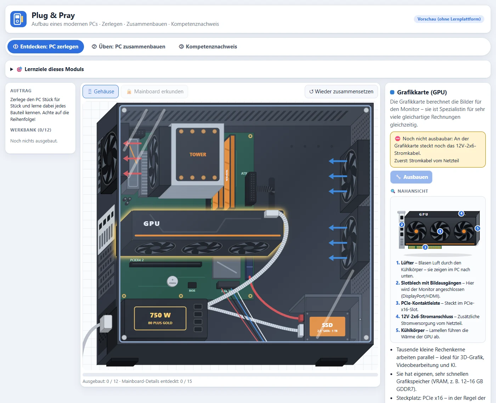
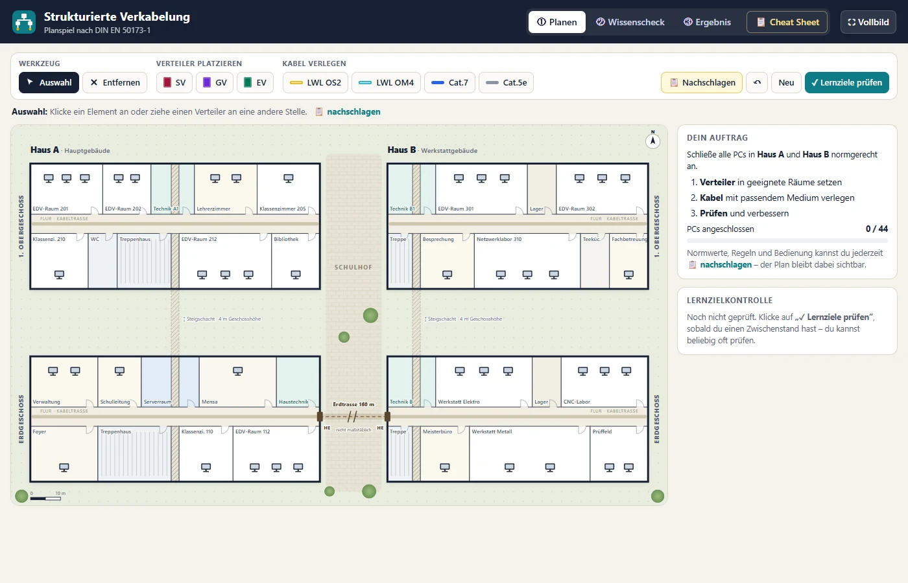
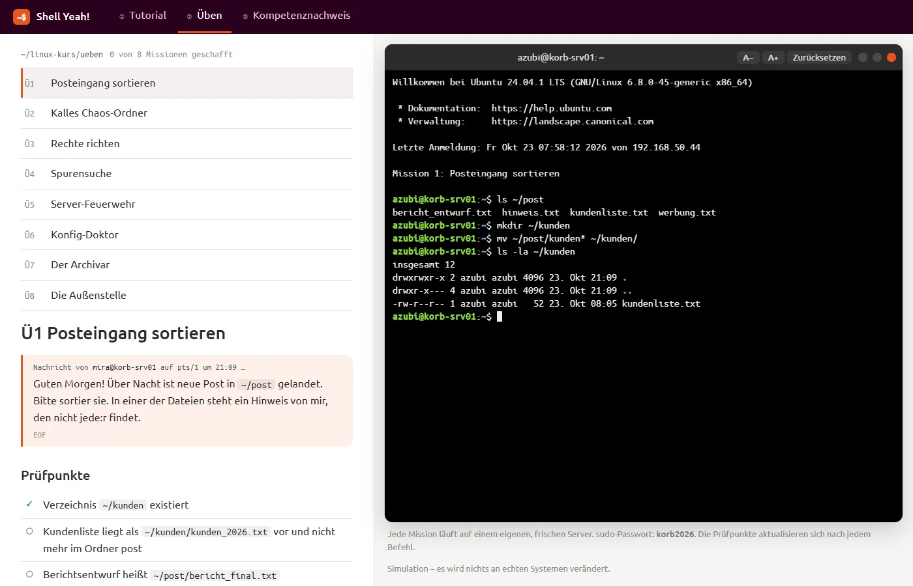
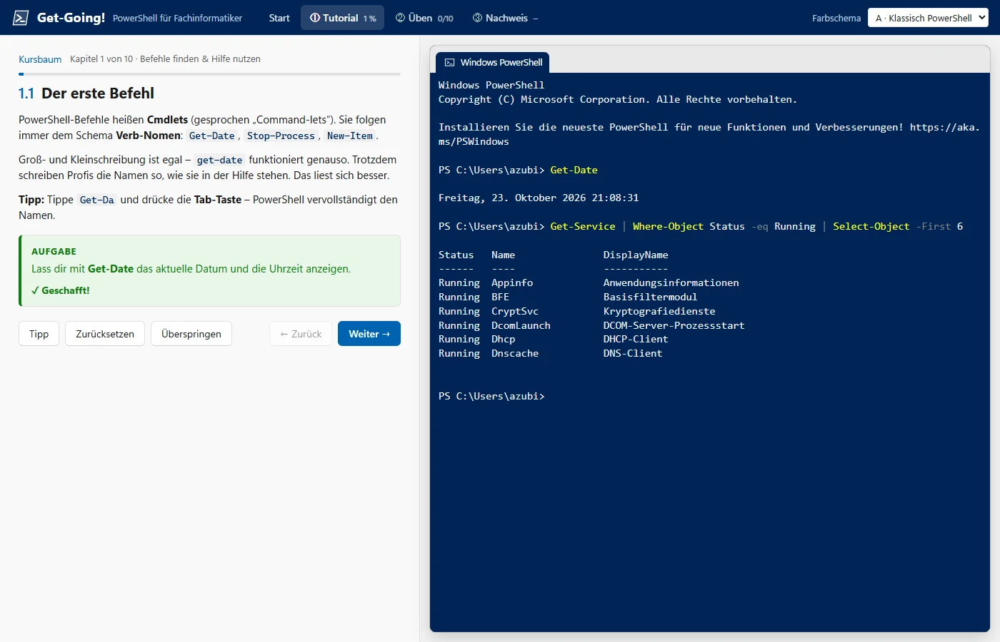

# PING – interaktive IT-Lernmodule als SCORM-Pakete

> **Neu: Leitfaden für evidenzbasierte Lernpakete** – [docs/leitfaden-lernpakete.md](docs/leitfaden-lernpakete.md)
>
> Der Leitfaden hilft Lehrkräften, auch ohne Medienpädagogik- oder Programmierkenntnisse, Lernpakete wissenschaftlich fundiert und einheitlich zu bauen. Er fasst die Forschungslage zusammen (u. a. Kerres, Mayer, 4C/ID), leitet daraus 13 Prinzipien ab (Muss/Soll mit Aufwand), beschreibt Paketstruktur, Entwicklungsprozess und technische Standards (SCORM 1.2, ByCS) und enthält eine Qualitätscheckliste für das Review sowie einen Vorschlag für ein KI-gestütztes Skill-Set. Neue und überarbeitete Pakete werden gegen diese Checkliste geprüft.

Fünf selbstgesteuerte Lernmodule für die Berufsschule (Fachinformatik, Einstiegsklasse). Jedes Modul läuft komplett im Browser, braucht keinen Server und lässt sich als SCORM-1.2-Paket in jede Lernplattform einbinden, z. B. Moodle, ILIAS oder die bayerische ByCS-Plattform.

Alle Module folgen demselben didaktischen Muster aus Erkunden, Üben und einer Lernzielkontrolle. Bei Shell Yeah! und Get-Going! heißt das **① Tutorial → ② Üben → ③ Kompetenznachweis**. Die Kontrolle wird automatisch bewertet und ans LMS gemeldet (bei diesen beiden bestanden ab 70 %).

## Die Module

| Modul | Thema | Inhalt |
|---|---|---|
| [Plug & Pray](packages/plug-and-pray) | Aufbau eines modernen PCs | PC zerlegen, zusammenbauen und nach Kundenauftrag konfigurieren – per Drag & Drop oder Antippen |
| [Netzwerktopologien erleben](packages/netzwerktopologien) | Netzwerktopologien | Topologien ausprobieren, mit Lernzielkontrolle |
| [Strukturierte Verkabelung](packages/strukturierte-verkabelung) | Gebäudeverkabelung (DIN EN 50173-1) | Planspiel zur Verkabelungsplanung |
| [Shell Yeah!](packages/shell-yeah) | Linux im Terminal | Simuliertes Ubuntu 24.04: Dateien, Rechte, Suchen, Prozesse, nano, Archive, `ip` |
| [Get-Going!](packages/get-going) | Windows PowerShell | Simulierter Windows Server 2025 mit PowerShell 5.1: Objekt-Pipeline, Skripte, Active Directory, Remoting |

### So sehen die Module aus

<table>
<tr><td width="50%"><a href="packages/plug-and-pray"></a><br><b>Plug & Pray</b></td><td width="50%"><a href="packages/netzwerktopologien"></a><br><b>Netzwerktopologien erleben</b></td></tr>
<tr><td width="50%"><a href="packages/strukturierte-verkabelung"></a><br><b>Strukturierte Verkabelung</b></td><td width="50%"><a href="packages/shell-yeah"></a><br><b>Shell Yeah!</b></td></tr>
<tr><td width="50%"><a href="packages/get-going"></a><br><b>Get-Going!</b></td></tr>
</table>

Weitere Bilder in den Steckbriefen der Module.

Die Inhalte sind auf Deutsch. Shell Yeah! und Get-Going! sind reine JavaScript-Simulationen, es wird nichts auf Deinem Rechner ausgeführt. Die Ordner `packages/<name>/` enthalten jeweils einen Steckbrief mit Lernzielen, Aufbau und didaktischen Entscheidungen (bei Netzwerktopologien und Strukturierte Verkabelung steht er noch aus).

## Benutzen

**Fertiges ZIP laden:** Unter [Releases](../../releases) liegen die gebauten Pakete (`<name>_scorm12.zip`). Das ZIP in der Lernplattform als SCORM-1.2-Aktivität hochladen, fertig.

**Immer aktuell einbinden:** Die Pakete der neuesten Version liegen zusätzlich unter festen Adressen ohne Weiterleitung, z. B. `https://dennismarcbusch.github.io/PING/plug-and-pray_scorm12.zip` (Übersicht: [dennismarcbusch.github.io/PING](https://dennismarcbusch.github.io/PING/)). In Moodle bzw. ByCS den Typ „Heruntergeladenes Paket“ wählen, diese Adresse eintragen und die automatische Aktualisierung einschalten.

**Selbst bauen:** Voraussetzung sind `bash` und `zip`.

```bash
./build.sh                  # alle Pakete -> dist/
./build.sh plug-and-pray    # ein Paket
```

Das Skript bricht ab, wenn `imsmanifest.xml` nicht im Wurzelverzeichnis des ZIPs liegt.

**Ohne Lernplattform ausprobieren:** `packages/<name>/src/index.html` im Browser öffnen. Der Fortschritt wird dann im `localStorage` gespeichert.

## Aufbau des Repos

```
packages/<name>/
  README.md   Steckbrief des Moduls
  src/        entpackter Paketinhalt (index.html, imsmanifest.xml, js/, css/ …)
  screenshots/  Bilder für die READMEs (nicht im ZIP)
tools/bycs-lernmodul/   Skill zum Bauen weiterer Module im gleichen Look
tools/screenshots/      erzeugt die Screenshots neu (Node + Edge headless)
build.sh                baut die ZIPs
```

Screenshots neu erzeugen (Windows, Node ≥ 22, Microsoft Edge): `node tools/screenshots/shots.mjs packages [paket …]`.

Im Repo liegen die Quellen, keine ZIPs (`dist/` ist ignoriert). Namen sind klein geschrieben mit Bindestrichen, ZIPs heißen `<name>_scorm12.zip`.

## Mitmachen

Fehler, Wünsche und Ideen gern als [Issue](../../issues). Ein neues Modul legst Du so an:

1. `packages/<name>/src/` mit `index.html` und `imsmanifest.xml` anlegen.
2. `packages/<name>/README.md` nach dem Muster der vorhandenen Steckbriefe schreiben.
3. Zeile in die Tabelle oben eintragen.

## Veröffentlichen (Maintainer)

- Tag `v1.0` setzen und pushen: Die GitHub Action baut alle Pakete, hängt die ZIPs an ein Release und stellt sie auf GitHub Pages (Voraussetzung: *Settings → Pages → Source: GitHub Actions*).
- Tag `plug-and-pray-v1.1`: baut nur dieses Paket, nur als Release. Pages bleibt auf dem Stand des letzten `v*`-Tags.

## Lizenz

Noch nicht festgelegt, bis dahin gilt das Urheberrecht des Autors. Die eingebetteten Schriften haben eigene Lizenzen: Ubuntu Font License in `packages/shell-yeah/src/fonts` (`UFL-LICENSE.txt`) und Cascadia Mono in `packages/get-going/src/fonts` (`LICENSE-CascadiaMono.txt`).
