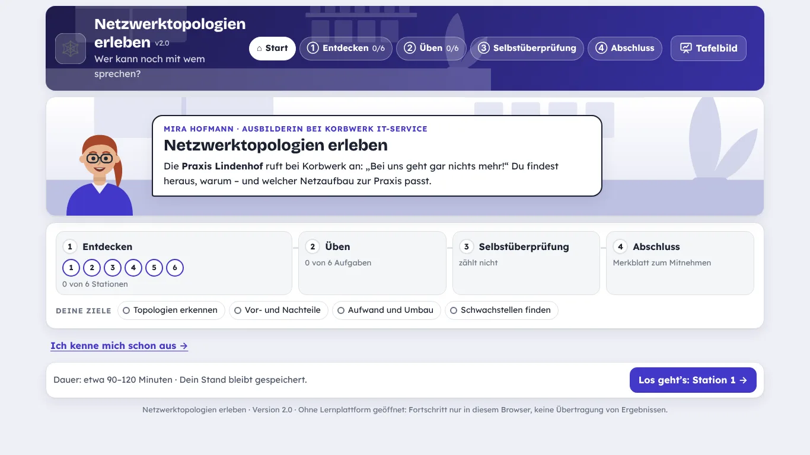
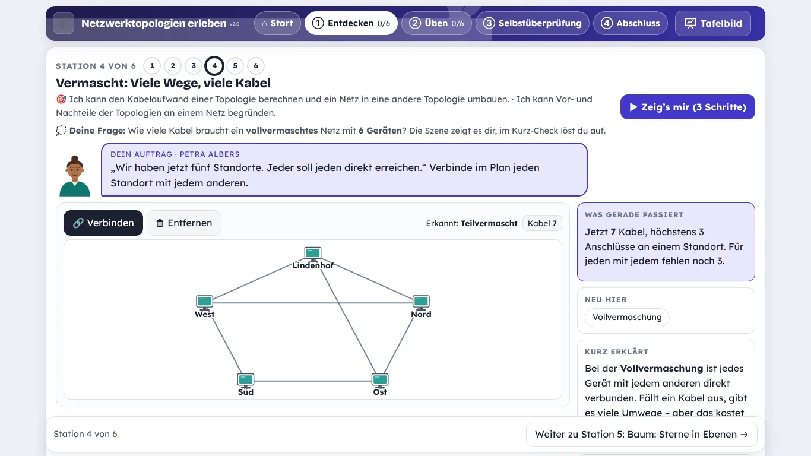
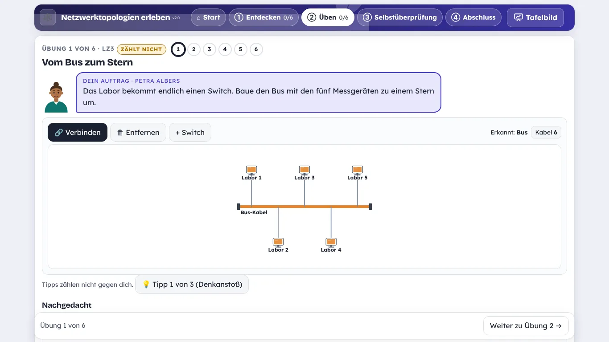
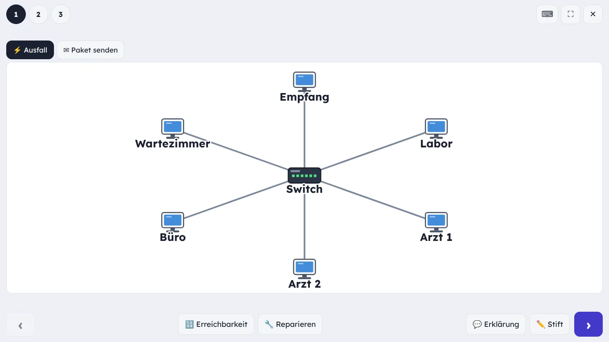

# SCORM-Paket „Netzwerktopologien erleben“

Stand: 12.11.2026 · **Version 2.0** · gebaut mit der Kompass-Vorlage 4.0 · Paket-ID `ping-netzwerktopologien` · SCORM 1.2 · selbstgesteuert (SeGeL-tauglich) · Fachinformatik, 10. Klasse · PC/Laptop und Tablet · etwa 90–120 Minuten

## So sieht es aus

*Startseite: Leitsituation, Lernpfad mit vier Zielen, ein Knopf*

*Station 1: Der Switch der Praxis Lindenhof ist ausgefallen – 0 von 15 PC-Paaren können noch Daten austauschen*

*Station 4: Standorte verbinden, bis jeder jeden erreicht; der Plan erkennt die Topologie und zählt die Kabel*

*Üben: den Bus des Labors zu einem Stern umbauen*

*Tafelbild: Ausfall im Stern, groß und ohne erklärenden Text*

## Leitidee

Am Netzplan eines Kunden ausprobieren statt Listen lernen: Geräte und Kabel ausfallen lassen, Pakete schicken, umbauen. Leitfrage: „Wer kann jetzt noch mit wem sprechen – und was hat es gekostet?“ Story: Korbwerk IT-Service (Ausbilderin Mira Hofmann, wie in Shell Yeah! und Get-Going!), Kunde Praxis Lindenhof (Petra Albers); Übungen bei der Druckerei Weiß und dem Autohaus Seidl; Selbstüberprüfung beim Autohaus Seidl.

## Lernziele

| | Lernziel | Etikett |
|---|---|---|
| LZ1 | Ich kann Bus, Ring, Stern, Baum, Voll- und Teilvermaschung an ihrem Aufbau erkennen und benennen. | Topologien erkennen |
| LZ2 | Ich kann Vor- und Nachteile der Topologien an einem Netz begründen. | Vor- und Nachteile |
| LZ3 | Ich kann den Kabelaufwand einer Topologie berechnen und ein Netz in eine andere Topologie umbauen. | Aufwand und Umbau |
| LZ4 | Ich kann Single Points of Failure finden und die Folgen eines Ausfalls einschätzen. | Schwachstellen finden |

Prüfpunkte und Fragen je Lernziel: `planung/lernziele-ueberpruefung.md`.

## Aufbau

- **① Entdecken** – sechs Stationen, jede mit Vorab-Frage als Leitfrage, Vorführung („Zeig’s mir“) mit Frage zum Selbsterklären, Szene am Netzplan, Kurz-Check (zählt nicht; ab Station 3 mit einer Wiederholungsfrage):
  S1 Stern (Ausfall von PC, Kabel, Switch) · S2 Bus (Kollision, Kabelbruch) · S3 Ring (Token, Doppelring) · S4 Vermascht (Standorte verbinden, n · (n − 1) / 2) · S5 Baum (Etagen- und Core-Switch) · S6 Erkennen (sechs Pläne ohne Beschriftung)
- **② Üben** – sechs Aufgaben in anderen Situationen, je drei gestufte Tipps und Reflexion mit Musterantwort: Bus → Stern, Ring → Vollvermascht, Stern → Baum, Ring → Teilvermascht (Profi), Pläne bestimmen, die eine Schwachstelle finden
- **③ Selbstüberprüfung** (zählt nicht, ab 80 % sitzt das Thema, beliebig oft) – Teil A: Netz des Autohauses Seidl analysieren und die Werkstatt vom Bus zum Stern umbauen (7 Prüfpunkte); Teil B: 2 Fragen je Lernziel aus einem Pool von 28 (Bildfragen, Hotspots, Zuordnen, Zahl)
- **④ Abschluss** – Auswertung je Lernziel neben der eigenen Einschätzung, Merkblatt zum Ergänzen mit Selbsttest, Ergebnis als PDF
- **Tafelbild** – drei Szenen für den Mittelteil des Inputs (Ausfall im Stern, Kabel bei Vermaschung, Teilbaum im Baum); Hinweise für die Folien-Notizen in `lehrer/tafelbild-notizen.md`

## Einsatz in der ByCS-Lernplattform

- Aktivität „Lernpaket“ (SCORM) **neu anlegen** – nicht Version 1 ersetzen, die ID ist neu.
- Versuche unbegrenzt, Bewertungsmethode „Höchste Bewertung“, Anzeige in neuem Fenster oder mindestens 1000 px breit.
- Aktivitätsabschluss an **„Abgeschlossen“** binden. Das Paket meldet nie bestanden; die Punktzahl ist eine Information. Der Kompetenznachweis liegt außerhalb des Pakets.
- Vor dem ersten Einsatz: einmal mit einem Schülertestkonto durchspielen, Kurztest mit drei bis fünf Schülern (`lehrer/erprobung.md`).

## Dateien

- `src/quelle/topologie.js` – der Netzplan („TopoNetz“) aus Version 1, als Gerät für die Vorlage: Ausfall, Paket senden, Kollision, Doppelring, Schwachstellen, Verbinden, Entfernen, Switch hinzufügen; Antippen und Tastatur, ohne Ziehen
- `src/quelle/paket.js` – Stationen, Übungen, Selbstüberprüfung, Merkblatt, Tafelbild; Bild- und Hotspot-Fragen
- `src/quelle/fragen.md` – alle übrigen Fragen als Markdown (zum fachlichen Prüfen)
- `src/js/inhalt.js` wird mit `paket.py bauen` (Kompass-Skill `lernpaket-bauen`) erzeugt und nie von Hand geändert; `quelle/` kommt nicht ins ZIP (`./build.sh` lässt es weg)
- `planung/` – Steckbrief, Lernziele und Selbstüberprüfung, Konzept
- `lehrer/` – Hinweise für das Tafelbild, Beobachtungsbogen für die Erprobung

## Entscheidungen

- Einfacher Ring fällt bei jedem Ausfall komplett aus (Token); Doppelring als zuschaltbare Gegenüberstellung.
- Bus-Kabelzahl = n Anschlüsse + 1 Hauptleitung; Baum ohne Kreise, Kabel = Geräte − 1.
- Stationen mit eigenen Szenen statt Simulationsmodus: Der Plan wird je Station neu aufgebaut, kein Zustand wandert mit.
- Erreichbarkeit als „x von y PC-Paaren“ – macht die Folgen eines Ausfalls zählbar.
- Topologien erkennen (LZ1) als eigene Station am Ende, weil die Lernenden dann alle sechs kennen.

## Änderungsprotokoll

- **2.0** (12.11.2026) – neu auf der Kompass-Vorlage 4.0: Selbstüberprüfung statt Lernzielkontrolle (zählt nicht, Status „abgeschlossen“, kein masteryscore), Stationen je Topologie mit Vorab-Frage und Vorführung, Übungen aus den Umbau-Aufgaben von Version 1, Teil A Autohaus Seidl, Fragenpool aus Version 1 mit Feedback je Falschantwort, Merkblatt, Tafelbild. Neue ID `ping-netzwerktopologien`.
- **1.0** (22.10.2026) – eigener Rahmen: Entdecken, Umbauen, Lernzielkontrolle (12 aus 28 Fragen, bestanden ab 60 %), ID `BSLIF_Netzwerktopologien_v1`.
