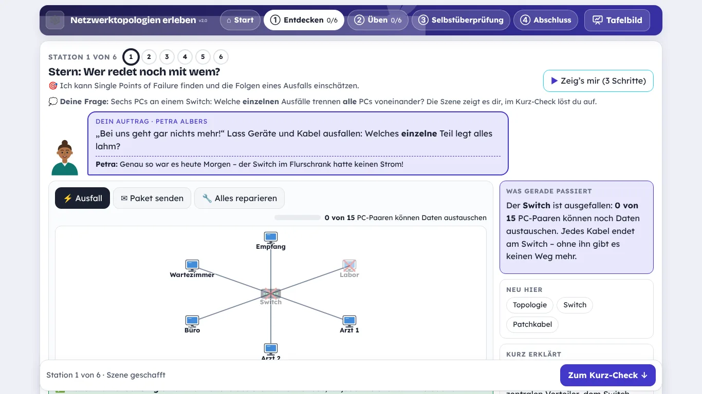
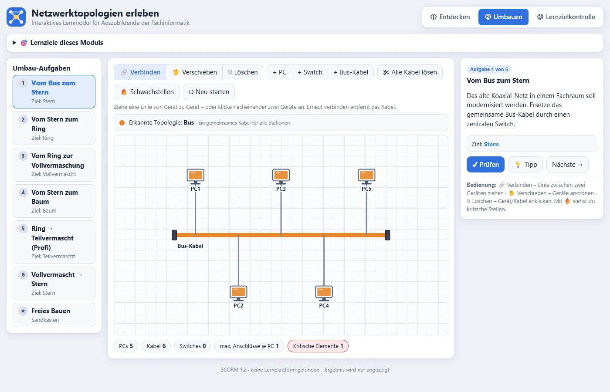

# SCORM-Paket „Netzwerktopologien erleben“

Stand: 12.11.2026 · **Version 0.1 (Prototyp von Version 2)** · gebaut mit der Kompass-Vorlage 4.0 · Paket-ID `ping-netzwerktopologien` · SCORM 1.2 · selbstgesteuert · Zielgruppe: Fachinformatik, 10. Klasse · PC/Laptop und Tablet

> **Prototyp:** Nur Station 1 (Stern) ist gebaut. Die rote Box „Hinweis für Autor:innen“ und die roten Punkte im Prüfskript zu Selbstüberprüfung und Datenübergabe sind in diesem Stand erwartet. Version 1 (eigener Rahmen, ID `BSLIF_Netzwerktopologien_v1`) liegt im Git-Verlauf und als Release `v1.4.1`.

## Leitidee

Am Netzplan eines Kunden ausprobieren statt Listen lernen: Geräte und Kabel ausfallen lassen, Pakete schicken, umbauen. Leitfrage: „Wer kann jetzt noch mit wem sprechen – und was hat es gekostet?“ Story: Korbwerk IT-Service (Ausbilderin Mira Hofmann), Kunde Praxis Lindenhof; Selbstüberprüfung beim Autohaus Seidl.

## Lernziele

LZ1 Topologien erkennen · LZ2 Vor- und Nachteile · LZ3 Aufwand und Umbau · LZ4 Schwachstellen finden (ausformuliert in `planung/lernziele-ueberpruefung.md`)

## Aufbau (geplant, siehe `planung/konzept.md`)

- ① Entdecken: S1 Stern · S2 Bus · S3 Ring · S4 Vermascht · S5 Baum · S6 Vergleich – je Station der Netzplan als Szene, Vorab-Frage als Leitfrage, Vorführung, Kurz-Check (zählt nicht)
- ② Üben: Umbau-Aufgaben aus Version 1 in anderen Situationen, drei gestufte Tipps, Reflexion
- ③ Selbstüberprüfung (zählt nicht, ab 80 % sitzt das Thema): Teil A Autohaus Seidl, Teil B 2 Fragen je Lernziel
- ④ Abschluss: Auswertung je Lernziel, Merkblatt
- Tafelbild: 3 Szenen (Ausfall im Stern, Kabelzahl bei Vermaschung, Teilbaum im Baum)

## Dateien

- `src/quelle/topologie.js` – der Netzplan („TopoNetz“) aus Version 1, als Gerät für die Vorlage (Antippen und Tastatur, ohne Ziehen)
- `src/quelle/paket.js` – Stationen, Szenen, Tafelbild · `src/quelle/fragen.md` – alle Fragen als Markdown
- `src/js/inhalt.js` wird mit `paket.py bauen` (Skill `lernpaket-bauen`) erzeugt und nie von Hand geändert; `quelle/` kommt nicht ins ZIP
- `planung/` – Steckbrief, Lernziele und Selbstüberprüfung, Konzept

## Entscheidungen

- Einfacher Ring fällt bei jedem Ausfall komplett aus (Token); Doppelring als zuschaltbare Gegenüberstellung.
- Bus-Kabelzahl = n Anschlüsse + 1 Hauptleitung; Baum ohne Kreise, Kabel = Knoten − 1.
- Stationen mit eigenen Szenen statt Simulationsmodus: Der Plan wird je Station neu aufgebaut, kein Zustand wandert mit.
- Neue Aktivität in der Lernplattform anlegen (neue ID), Version 1 nicht ersetzen. Abschluss an „abgeschlossen“ binden; das Paket meldet nie bestanden.

## Screenshots

Die Bilder unten zeigen noch Version 1 und werden mit dem Ausbau ersetzt.

