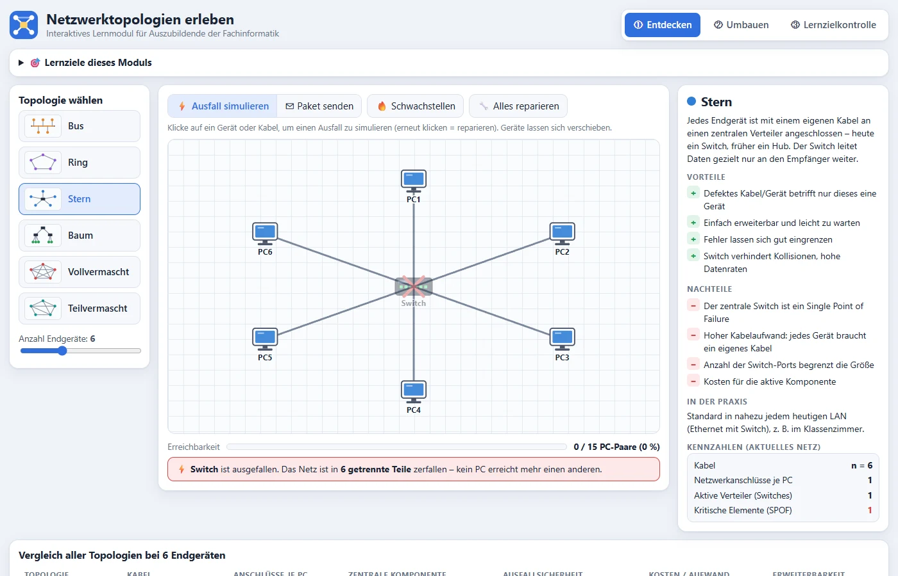
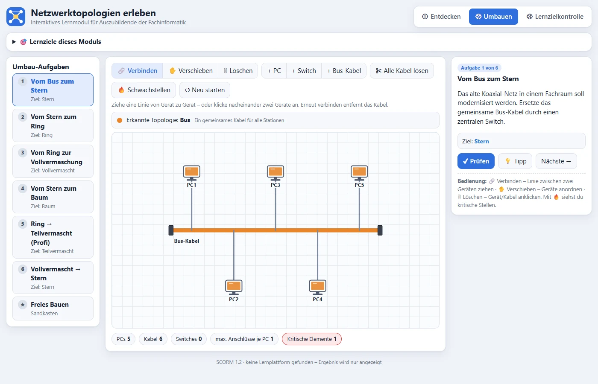
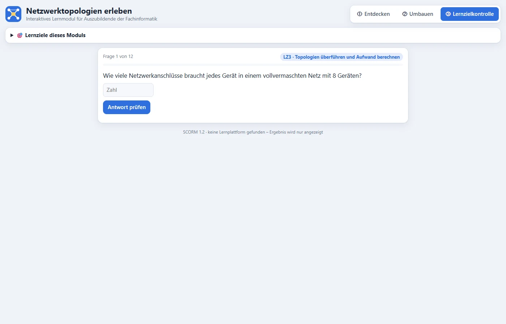

# SCORM-Paket „Netzwerktopologien erleben“

SCORM 1.2 · ein Paket (index.html + imsmanifest.xml), selbstgesteuert · Zielgruppe: Fachinformatik

## So sieht es aus

*① Entdecken: Ausfall simulieren – fällt der Switch aus, zerfällt der Stern*

*② Umbauen: Topologien Schritt für Schritt überführen*

*③ Lernzielkontrolle: 12 Fragen zu den Lernzielen*

> Steckbrief noch nicht angelegt: Leitidee, Lernziele, Aufbau und Entscheidungen hier ergänzen
> (Vorlage: `packages/pc-aufbau/README.md`).
