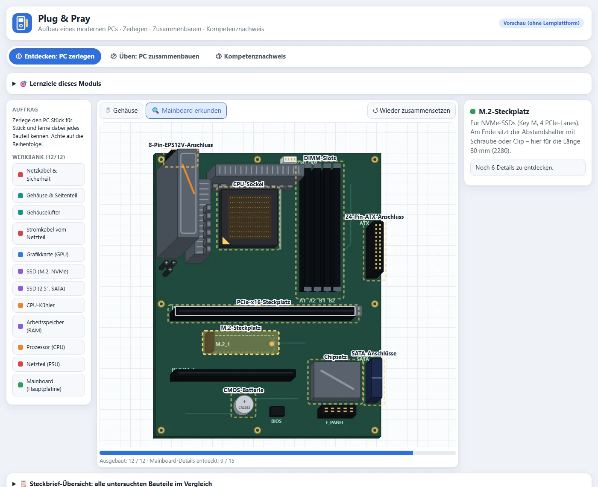
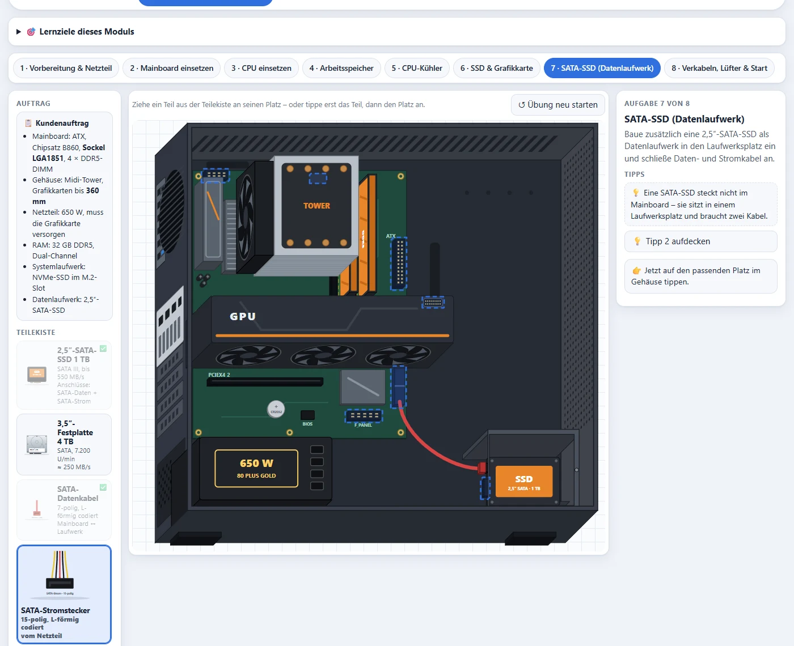
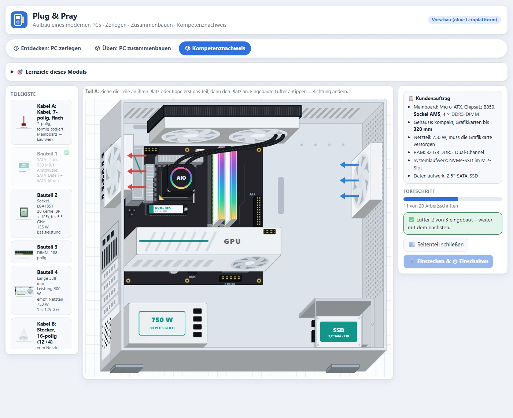

# SCORM-Paket „Plug & Pray“ (Aufbau eines modernen PCs)

Stand: 23.10.2026 · SCORM 1.2 · ein Paket `plug-and-pray_scorm12.zip` (index.html + imsmanifest.xml, ca. 60 KB), selbstgesteuert · Zielgruppe: Fachinformatik-Einstiegsklasse

## So sieht es aus

*① Entdecken: Bauteil anklicken, Steckbrief mit Nahansicht lesen, in sinnvoller Reihenfolge ausbauen*

*Mainboard-Werkbank: Steckplätze und Anschlüsse entdecken*

*② Üben: geführter Zusammenbau, hier Aufgabe 7 mit SATA-SSD, Daten- und Stromkabel*

*③ Kompetenznachweis: anderer PC (weißes Gehäuse, AIO), Teile ohne Namen*

## Name
„Plug & Pray“ (vom Lehrer gewählt) – Wortspiel auf „Plug & Play“, passend zum Einschalten nach dem Zusammenbau. Untertitel „Aufbau eines modernen PCs“. Manifest-Identifier `ping-plug-and-pray`.

## Leitidee
PC zerlegen → wieder zusammenbauen → anderen PC nach Kundenauftrag bauen. Teile per Drag & Drop oder per Antippen (erst Teil, dann Platz – tablettauglich).

## Darstellung
- 3D-Schrägbild ins offene Gehäuse (Blick schräg von vorne-links-unten): Bauteile als Körper mit Tiefe. Sichtbar sind RAM-Module von der Seite, die Lüfter an der Unterseite der Grafikkarte, Kühlerlüfter, Frontlüfter und die Rückwand mit I/O, Slotblechen und Netzteilbuchse. Werkbank und Hotspot-Fragen zeigen das Mainboard stärker geneigt.
- Realismus-Stufe 1 (23.10.): M.2-SSD in echten Proportionen (2280) mit Controller, NAND-Chips bzw. Etikett; Mainboard mit Spulen am VRM, Kondensatoren, PCIe-Metallverstärkung, CMOS „CR2032“.
- 3D-Ansicht (abschaltbar): Schalter „🧊 3D“ an jeder Bühne zeigt den PC als echtes 3D-Modell (WebGL, ohne externe Bibliothek, gebaut aus denselben Maßen). Ziehen dreht, Mausrad bzw. zwei Finger zoomen, „⟳ Drehen“ dreht automatisch. In Entdecken lassen sich Bauteile und auf der Werkbank die Mainboard-Details auch in 3D antippen und ausbauen; in Üben und Kompetenznachweis ist 3D eine reine Ansicht, eingebaut wird in 2D (wählt man ein Teil, schaltet die Bühne zurück). Im Steckbrief dreht „In 3D drehen“ das einzelne Bauteil. Abschalten: Schalter „3D: an/aus“ im Kopf (pro Person gespeichert), Startadresse mit `?3d=0` oder `ALLOW_3D = false` im Code. Ohne WebGL bleiben die Schalter verborgen.
- Produktansichten aller Bauteile (nah am Original, je Variante A dunkel/orange und B weiß/türkis) für Teilekiste, Bildfragen und die „Nahansicht“ im Steckbrief mit nummerierten Hinweisen (z. B. NVMe: Kontaktleiste mit Key M, Controller, DRAM-Cache, NAND-Flash, Schraubenkerbe). Ausgewähltes Teil in der Teilekiste wird groß angezeigt.
- CPU-Bilder je Sockel: AM5 (Heatspreader mit Aussparungen), LGA (rechteckig), AM4 als Unterseite mit Pins.
- Besprochene weitere Stufen (noch nicht umgesetzt): echtes 3D mit three.js; eigene Fotos eines zerlegten Schul-PCs (Stativ, Ebenen); Mischform mit Fotos in Steckbrief/Teilekiste.

## Lernziele
- LZ1 Komponenten erkennen (auch in anderer Bauform)
- LZ2 Funktionen beschreiben
- LZ3 Steckplätze & Anschlüsse zuordnen
- LZ4 Sicher & in sinnvoller Reihenfolge (Strom, ESD, Wärmeleitpaste, Airflow)
- LZ5 Kompatibilität nach Kundenauftrag (Sockel, DDR/DIMM, Formfaktor, GPU-Länge, Netzteil)

## Aufbau
- ① Entdecken: Midi-Tower (ATX, Tower-Luftkühler). 15 Bauteile mit Steckbrief und Nahansicht untersuchen und ausbauen (inkl. 2,5″-SATA-SSD hochkant im Laufwerkskäfig am Gehäuseboden). GPU-Stromkabel, SATA-Daten- und SATA-Stromkabel sind eigene Elemente, ATX, EPS und Front-Panel ziehen gemeinsam ab. Abhängigkeiten (Netzkabel → Seitenteil → GPU-Stromkabel → GPU → M.2 darunter; Kühler → RAM/CPU; SATA-Daten + SATA-Strom → SATA-SSD …). Danach Mainboard-Werkbank mit 15 Details. Steckbrief-Übersicht als aufklappbare Tabelle (standardmäßig zu).
- ② Üben: geführter Zusammenbau in 8 Aufgaben (Netzteil, Mainboard, CPU, RAM Dual-Channel A2/B2, Kühler + Wärmeleitpaste, SSD & GPU, SATA-SSD als Datenlaufwerk mit Daten- und Stromkabel, Verkabelung/Lüfter/Start mit POST). Kundenauftrag zufällig (AM5/LGA1851, GPU-Länge, Netzteil-W), je Kategorie Fehlteile mit Begründung, 3 gestufte Tipps, Reflexionsfrage.
- ③ Kompetenznachweis: weißes Kompaktgehäuse, Micro-ATX mit anderem Layout (M.2 über der GPU), AIO-Wasserkühlung mit Radiator unter der Decke, Blower-Grafikkarte, RGB-RAM, Bauteile ohne Namen. Teil A: 25 Prüfpunkte (inkl. SATA-SSD mit Daten- und Stromkabel, Fehlteile 3,5″-HDD und Molex), freie Reihenfolge, keine Tipps. Teil B: 12 Fragen aus Pool von 41 (2/4/2/2/2 je LZ; MC, Bild, Hotspot, Zuordnen, Zahl). A und B je 50 %, bestanden ab 70 %.

## Entscheidungen
- Grafikkarten generisch („Grafikkarte A/B/C“ mit Länge/Watt), CPUs real (Ryzen 7 9700X, Core Ultra 7 265K + Fehlteile AM4/LGA1700).
- Im Nachweis wirken sich Fehler im POST aus (Single-Channel, Überhitzung ohne Paste, Wärmestau) statt direkt erklärt zu werden.
- SCORM: score.raw = bestes Ergebnis, lesson_status passed/failed, masteryscore 70, Fortschritt in suspend_data, Name aus cmi.core.student_name vorbelegt; Ergebnis druckbar als PDF.
- Getestet in nachgebautem SCORM-1.2-Player; Test in der echten ByCS Lernplattform steht noch aus.
