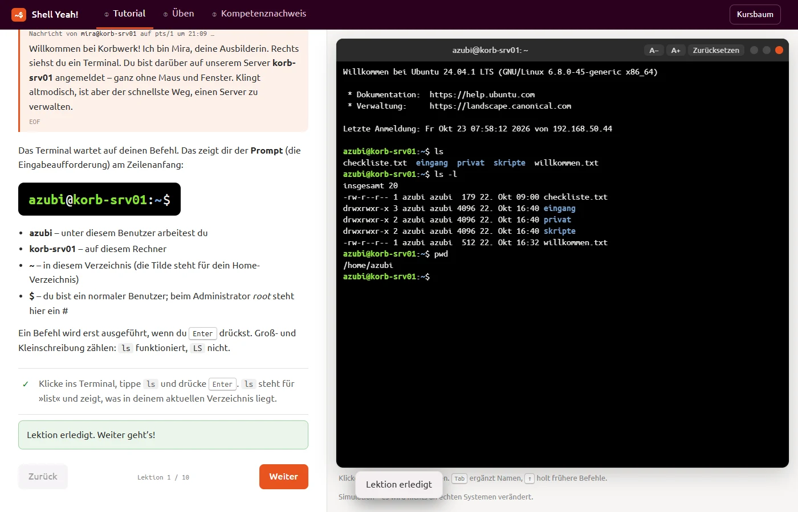
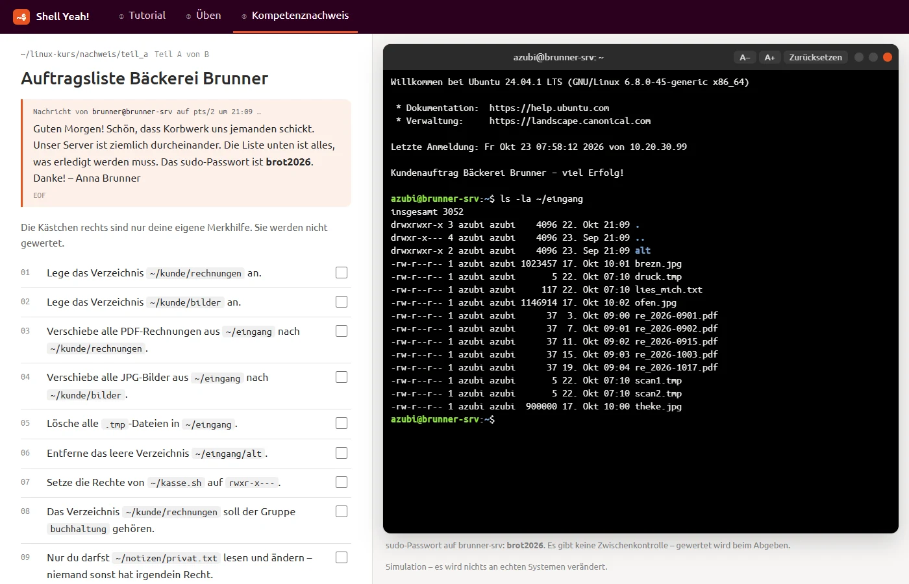

# SCORM-Paket „Shell Yeah!“ (Linux im Terminal)

Stand: 21.10.2026 · SCORM 1.2 · ein Paket shell-yeah_scorm12.zip (index.html + imsmanifest.xml + js/css/fonts, ca. 300 KB), selbstgesteuert · Zielgruppe: Fachinformatik-Einstiegsklasse, nur PC/Laptop

## So sieht es aus

*① Tutorial: Lektionen links, simuliertes Ubuntu-Terminal rechts*

*② Üben: Missionen mit Live-Prüfpunkten*

*③ Kompetenznachweis: Auftragsliste am Kundenserver*

## Leitidee
Inhaltlicher Nachbau von linuxsurvival.com (alle Module außer Drucken) plus ip, nano und Archive. Name „Shell Yeah!“ (vom Lehrer gewählt). Story: erster Tag als Azubi bei „Korbwerk IT-Service“, Ausbilderin Mira Hofmann (Nachrichten im Stil von `write`), Server korb-srv01, Altlasten des Ex-Admins Kalle. Nachweis beim Kunden „Bäckerei Brunner“ (Server brunner-srv).

## Technik
- Reine JavaScript-Simulation eines deutschen Ubuntu 24.04 (kein Alpine/v86): Dateisystem mit Rechten, bash-Parser (Pipes, Umleitungen inkl. 2>/dev/null, Globs, ~benutzer, Brace-Expansion), deutsche Fehlermeldungen, sudo mit Passwortabfrage, Prozesse, Tab-Vervollständigung, Verlauf.
- Echte Pager (less/more/man mit Suche) und nano (^O/^X/^K/^U, Suche per F6 statt Strg+W wegen Browser).
- ~45 eigene deutsche man-Pages, `man -k`, `help` für Builtins.
- Netzwerkmodell: ping funktioniert erst bei korrekter Konfiguration (Link up, Adresse mit Präfix, Default-Route); realistische Meldungen (Netzwerk nicht erreichbar / Zielhost nicht erreichbar / Namensauflösung). ifconfig/route bewusst „nicht installiert“.
- Archive als Objekte: tar (c/x/t, z/j/J, -C), gzip/bzip2/xz, zip/unzip mit plausiblen Größen.
- Optik: Farbschema „Yaru Light“ (vom Lehrer aus drei Varianten gewählt): heller Lesebereich wie Standard-Ubuntu, Kopfleiste in Aubergine #2C001E, Yaru-Orange #E95420 als einziger Akzent, Terminal klassisch schwarz mit Tango-Farben. Schriften Ubuntu/Ubuntu Mono eingebettet. Startseite: Login-Terminal + Menü /tutorial, /ueben, /nachweis; Kursbaum als `tree`.

## Lernziele
- LZ1 Navigieren & Anzeigen · LZ2 Dateien/Verzeichnisse verwalten · LZ3 Rechte, Gruppen, sudo · LZ4 Suchen, Filtern, Umleiten · LZ5 Prozesse & Speicherplatz · LZ6 nano · LZ7 Packen/Komprimieren · LZ8 ip-Konfiguration

## Aufbau
- ① Tutorial: 8 Kapitel, 66 Lektionen mit Aufgaben im Terminal (Zustands-/Befehlsprüfung, Antwortfelder), Tipp → Lösung, Kurz-Check (4 MC) je Kapitel. Springen per Kursbaum; Serverzustand wird durch Nachspielen der Musterlösungen erzeugt („Zurücksetzen“, „Überspringen“).
- ② Üben: 8 Missionen (je Kapitel) auf frischem Server, Live-Prüfpunkte, 3 gestufte Tipps, Reflexionsfrage mit Musterantwort.
- ③ Kompetenznachweis: Teil A 21 Prüfpunkte am Server (freie Reihenfolge, keine Tipps, Bewertung beim Abgeben); Teil B 12 Fragen aus Pool von 49 (1/2/2/2/1/1/1/2 je LZ; MC, Terminal-Bild, Hotspot, Zuordnen, Zahl). A und B je 50 %, bestanden ab 70 %.

## Entscheidungen
- sudo-Passwörter: korb2026 (Tutorial/Üben), brot2026 (Nachweis).
- Kapitel 8 setzt das Netzwerk zurück („Umzug ins neue Rack“); Hinweis, dass ip nicht dauerhaft ist (Netplan).
- Nachweis muss in einer Sitzung abgeschlossen werden (Serverzustand nicht in suspend_data).
- SCORM: score.raw = bestes Ergebnis, lesson_status passed/failed, masteryscore 70, Fortschritt in suspend_data (~0,5 KB), Name aus cmi.core.student_name, Ergebnis druckbar als PDF mit Unterschriftszeilen. localStorage nur ohne LMS (geteilte Schul-PCs).
- Automatisierte Tests: alle Lektionen, Missionen und Teil A per Musterlösung lösbar.
