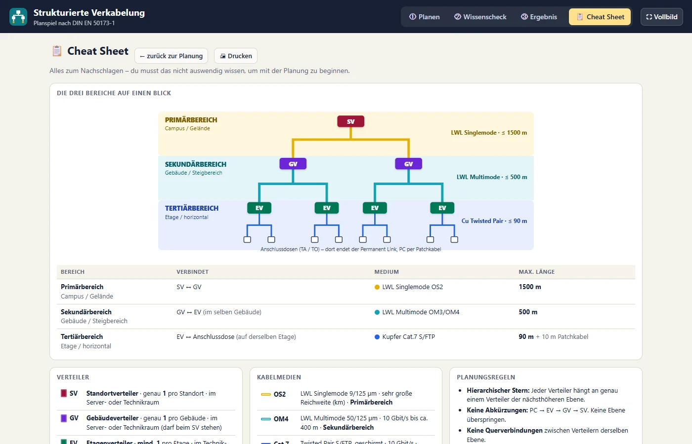

# SCORM-Paket „Strukturierte Verkabelung – Planspiel“

SCORM 1.2 · ein Paket (index.html + imsmanifest.xml), selbstgesteuert · Zielgruppe: Fachinformatik · Bezug: DIN EN 50173-1

## So sieht es aus

*① Planen: Verteiler setzen und Kabel verlegen auf dem Lageplan zweier Gebäude*

*Cheat Sheet: Primär-, Sekundär- und Tertiärbereich mit Medien und Längen*

> Steckbrief noch nicht angelegt: Leitidee, Lernziele, Aufbau und Entscheidungen hier ergänzen
> (Vorlage: `packages/pc-aufbau/README.md`).
