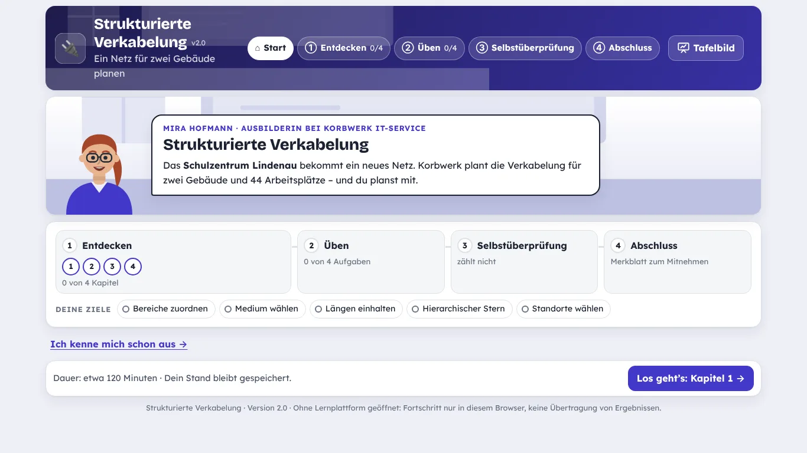
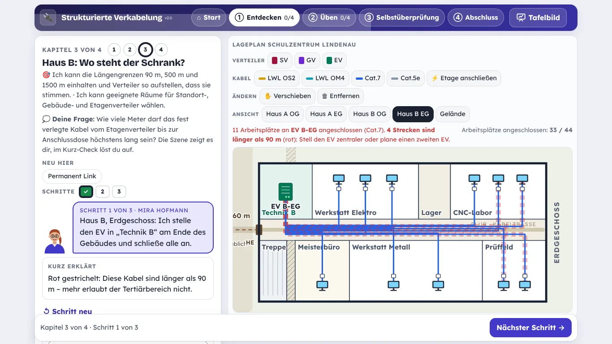
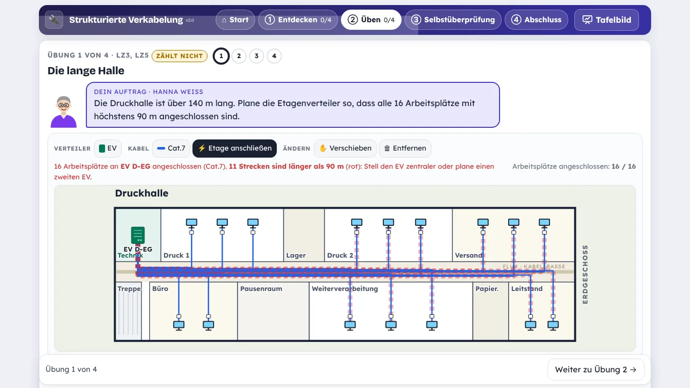
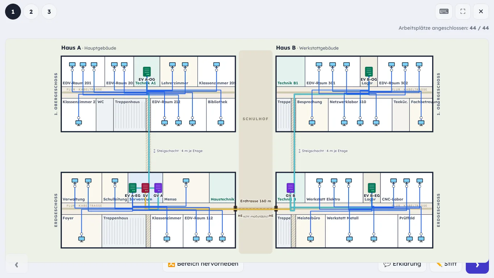

# SCORM-Paket „Strukturierte Verkabelung“

Stand: 12.11.2026 · **Version 2.0** · gebaut mit der Kompass-Vorlage 4.0 (Simulationsmodus) · Paket-ID `ping-strukturierte-verkabelung` · SCORM 1.2 · selbstgesteuert (SeGeL-tauglich) · Fachinformatik, 10. Klasse · PC/Laptop, Tablet möglich · etwa 120 Minuten · Bezug: DIN EN 50173-1

## So sieht es aus

*Startseite: Leitsituation, Lernpfad mit fünf Zielen, ein Knopf*

*Kapitel 3: Der EV steht am Ende von Haus B – vier Kabel sind länger als 90 m (rot)*

*Üben: In der 140 m langen Druckhalle reicht ein Etagenverteiler nicht*

*Tafelbild: fertiger Lageplan, Bereiche nacheinander hervorheben*

## Leitidee

Planen statt Tabellen lernen: Im Lageplan aus Version 1 stellen die Lernenden Verteiler auf, verlegen Kabel und sehen sofort Bereich, Medium und Länge. Im Entdecken entsteht Schritt für Schritt die komplette Verkabelung des Schulzentrums Lindenau (zwei Gebäude, 44 Arbeitsplätze) – der Plan bleibt über alle Kapitel erhalten. Story: Korbwerk IT-Service (Mira Hofmann), Hausmeister Ali Demir; Übungen im Hotel Sonne und in der Druckerei Weiß; Selbstüberprüfung beim Autohaus Seidl.

## Lernziele

| | Lernziel | Etikett |
|---|---|---|
| LZ1 | Ich kann Primär-, Sekundär- und Tertiärbereich den Verbindungen zwischen Standort-, Gebäude- und Etagenverteiler und Arbeitsplatz zuordnen. | Bereiche zuordnen |
| LZ2 | Ich kann für jeden Bereich das passende Übertragungsmedium wählen und begründen. | Medium wählen |
| LZ3 | Ich kann die Längengrenzen 90 m, 500 m und 1500 m einhalten und Verteiler so aufstellen, dass sie stimmen. | Längen einhalten |
| LZ4 | Ich kann eine Verkabelung als hierarchischen Stern aufbauen: Jedes Gerät hängt an genau einem Verteiler der nächsthöheren Ebene. | Hierarchischer Stern |
| LZ5 | Ich kann geeignete Räume für Standort-, Gebäude- und Etagenverteiler wählen. | Standorte wählen |

## Aufbau

- **① Entdecken** (Simulationsmodus, links die Lektion, rechts der Lageplan) – vier Kapitel mit 3–5 Schritten, je Kapitel eine Vorführung mit Frage zum Selbsterklären, Vorab-Frage als Leitfrage und Kurz-Check (zählt nicht):
  K1 Ein Arbeitsplatz, ein Kabel (EV, Tertiärbereich, Cat.7) · K2 Hoch und runter (GV, Sekundärbereich, LWL OM4 durch den Schacht) · K3 Haus B: Wo steht der Schrank? (90 m, EV in die Mitte) · K4 Zwischen den Gebäuden (SV, Primärbereich, LWL OS2 über den Hof)
- **② Üben** – vier Aufgaben an anderen Orten, je drei gestufte Tipps und Reflexion: lange Druckhalle (zwei EVs), falsche Medien im Hotel, Kreuz-und-quer-Verkabelung im Hotel, Schränke am falschen Ort
- **③ Selbstüberprüfung** (zählt nicht, ab 80 % sitzt das Thema) – Teil A: Autohaus Seidl komplett planen, ohne Rückmeldung, 9 Prüfpunkte aus den Prüfregeln von Version 1; Teil B: 2 Fragen je Lernziel aus einem Pool von 20
- **④ Abschluss** – Auswertung je Lernziel, Merkblatt zum Ergänzen mit Selbsttest, Ergebnis als PDF
- **Tafelbild** – drei Szenen (drei Bereiche, 90 Meter, Stern in Ebenen); Hinweise für die Folien-Notizen in `lehrer/tafelbild-notizen.md`

## Einsatz in der ByCS-Lernplattform

- Aktivität „Lernpaket“ (SCORM) **neu anlegen** – nicht Version 1 ersetzen, die ID ist neu.
- Versuche unbegrenzt, Bewertungsmethode „Höchste Bewertung“, Anzeige in neuem Fenster oder mindestens 1000 px breit (der Lageplan braucht Platz).
- Aktivitätsabschluss an **„Abgeschlossen“** binden. Das Paket meldet nie bestanden; die Punktzahl ist eine Information. Der Kompetenznachweis liegt außerhalb des Pakets.
- Vor dem ersten Einsatz: einmal mit einem Schülertestkonto durchspielen, Kurztest mit drei bis fünf Schülern (`lehrer/erprobung.md`).

## Dateien

- `src/quelle/verkabelung.js` – der Planer („VK“) aus Version 1 als Gerät: vier Gelände (Schulzentrum Lindenau, Druckerei Weiß, Hotel Sonne, Autohaus Seidl), Ansicht je Etage oder ganzes Gelände, Verteiler aufstellen, Kabel verlegen, Etage anschließen, Medium ändern, verschieben, entfernen; Längen und Prüfregeln wie in Version 1, nach Lernzielen gegliedert
- `src/quelle/paket.js` – Kapitel, Übungen, Selbstüberprüfung, Merkblatt, Tafelbild
- `src/quelle/fragen.md` – alle Fragen als Markdown (zum fachlichen Prüfen)
- `src/js/inhalt.js` wird mit `paket.py bauen` erzeugt; `quelle/` kommt nicht ins ZIP
- `planung/` – Steckbrief, Lernziele und Selbstüberprüfung, Konzept
- `lehrer/` – Hinweise für das Tafelbild, Beobachtungsbogen

## Entscheidungen

- Längen wie in Version 1: 0,16 m je Zeichnungseinheit, 4 m je Etage, Erdtrasse 160 m (nicht maßstäblich), 2 m Reserve je Strecke; Kabel laufen über Flur, Steigschacht und Hauseinführung.
- „⚡ Etage anschließen“ schließt jeden freien Arbeitsplatz an den **nächsten** EV seiner Etage an – so lassen sich Etagen mit zwei EVs planen, ohne 44 Kabel einzeln zu ziehen.
- Verteiler lassen sich nicht in Flur, Schacht, Treppenhaus oder WC stellen; andere ungeeignete Räume sind möglich und werden begründet bemängelt (damit der Fehler sichtbar wird).
- Kupfer bis 90 m im Steigbereich ist zulässig, gilt in der Selbstüberprüfung aber als nicht erfüllt (Standard ist LWL).
- Der Plan-Code und das kopierbare Ergebnisprotokoll aus Version 1 entfallen; das Ergebnis-PDF der Vorlage ersetzt sie.

## Änderungsprotokoll

- **2.0** (12.11.2026) – neu auf der Kompass-Vorlage 4.0 im Simulationsmodus: Selbstüberprüfung statt Lernzielkontrolle (zählt nicht, Status „abgeschlossen“), Kapitel mit Vorab-Frage und Vorführung, Übungen an drei neuen Orten, Teil A Autohaus Seidl, Wissenscheck aus Version 1 als Kurz-Checks und Pool mit Feedback, Merkblatt statt Cheat Sheet, Tafelbild. Neue ID `ping-strukturierte-verkabelung`.
- **1.0** (22.10.2026) – Planspiel im eigenen Rahmen: ein Planungsauftrag für 44 PCs, Wissenscheck (10 Fragen), Cheat Sheet, Gewichtung Planung 70 % + Quiz 30 %, bestanden ab 80 %, ID `BSLIF_STRUKTURIERTE_VERKABELUNG`.
